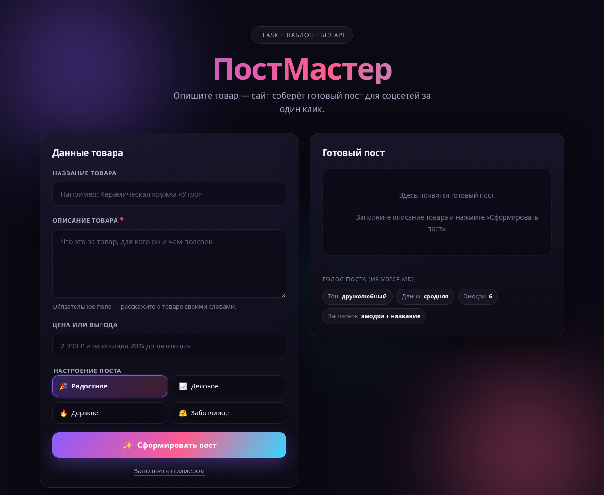
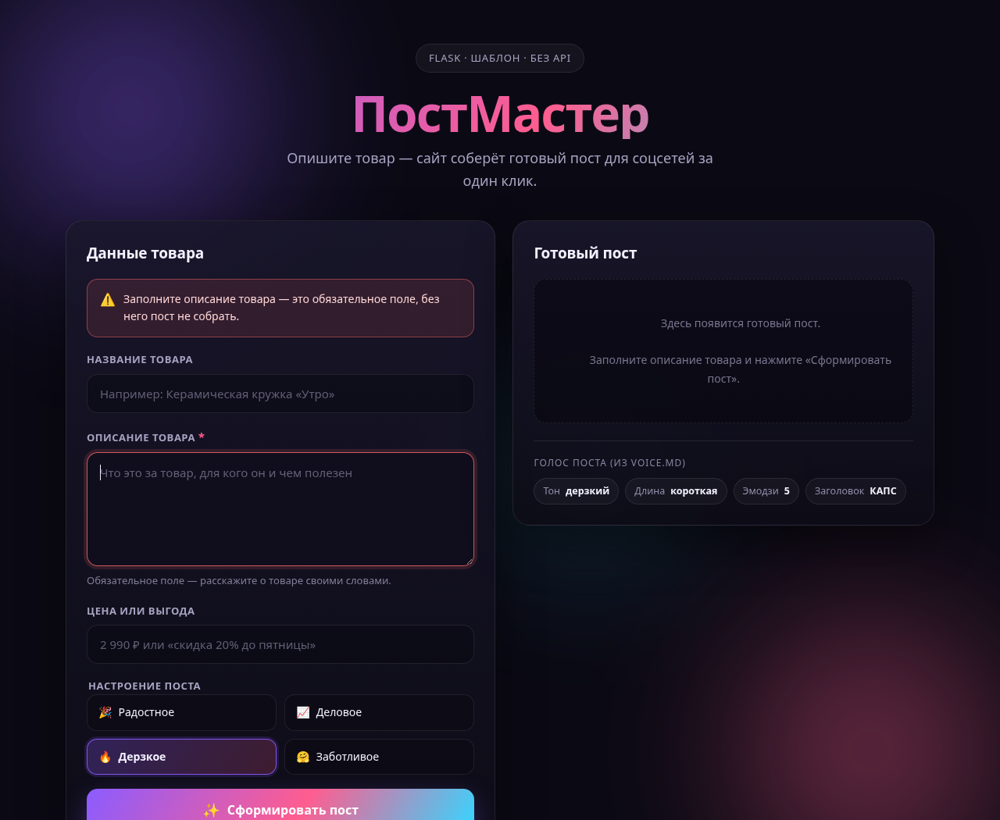
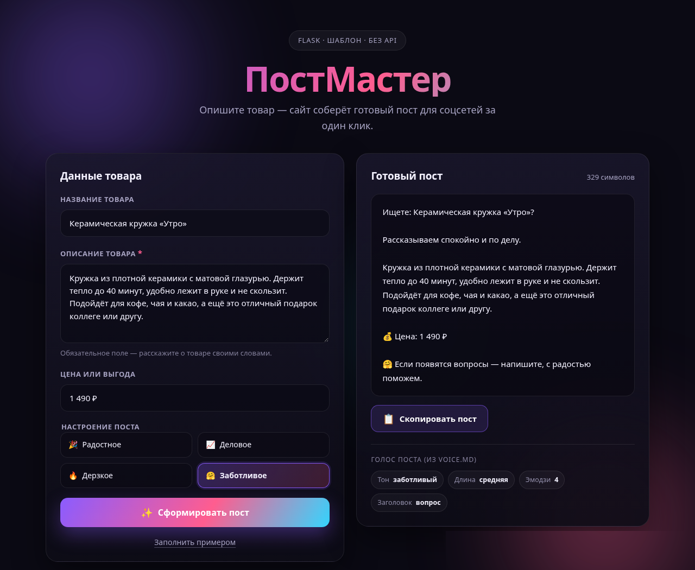

# ПостМастер — генератор постов для товара

Простой сайт на **Flask**: вы описываете товар, выбираете настроение — и получаете
готовый текст поста для соцсетей. Всё собирается **по шаблону**, без API,
без нейросетей и без баз данных.



## Что умеет сайт

* поле **«Название товара»** (можно оставить пустым);
* поле **«Описание товара»** — обязательное, помечено звёздочкой `*`;
* поле **«Цена или выгода»** (например, `1 490 ₽` или `скидка 20% до пятницы`);
* выбор **настроения поста**: Радостное, Деловое, Дерзкое, Заботливое;
* кнопка **«Сформировать пост»** — текст собирается по шаблону;
* блок **«Готовый пост»** с количеством символов;
* кнопка **«Скопировать пост»** — после нажатия появляется сообщение
  «Пост скопирован»;
* **предупреждение**, если описание товара не заполнено.

Стиль постов (тон, длина, эмодзи, заголовок) настраивается в файле
[`voice.md`](voice.md) — без правки кода.

## Структура проекта

```
.
├── app.py                 # вся логика: чтение voice.md и сборка поста
├── voice.md               # настройки формирования поста (тон, длина, эмодзи, заголовок)
├── requirements.txt       # зависимости (только Flask)
├── templates/
│   └── index.html         # страница сайта (форма + блок «Готовый пост»)
├── static/
│   ├── css/style.css      # оформление: тёмная тема, градиенты, анимации
│   └── js/app.js          # копирование поста и кнопка «Заполнить примером»
└── docs/screenshots/      # картинки для этого файла
```

## Как запустить

Нужен Python 3.9 или новее.

```bash
# 1. Перейти в папку проекта
cd 2026-10_ZC_Intensiv-VC_Site-GenPost-VK_ClineWeb

# 2. (по желанию) создать виртуальное окружение
python -m venv venv
source venv/bin/activate        # Windows: venv\Scripts\activate

# 3. Установить зависимости
pip install -r requirements.txt

# 4. Запустить сайт
python app.py
```

Откройте в браузере **http://127.0.0.1:5000** — сайт работает локально.
Остановить сервер: `Ctrl + C` в терминале.

Быстрая проверка без браузера (если сервер уже запущен):

```bash
curl http://127.0.0.1:5000/
```

Подсказка: кнопка «Заполнить примером» на странице сама подставляет товар —
удобно, чтобы сразу увидеть результат.

### Запуск прямо на GitHub (Codespaces)

Если не хочется ничего ставить на компьютер:

1. На странице репозитория нажмите **Code → Codespaces → Create codespace on main**.
2. В открывшемся терминале выполните:

   ```bash
   pip install -r requirements.txt
   python app.py
   ```

3. Откроется вкладка **Ports** — нажмите «Открыть в браузере» у порта **5000**
   (или на всплывающее сообщение «Open in Browser»).

Сайт откроется в новой вкладке — точно так же, как при локальном запуске.

## Как менять стиль постов: `voice.md`

`app.py` читает `voice.md` при каждом нажатии кнопки «Сформировать пост»,
поэтому после правок достаточно обновить страницу — перезапуск не нужен.

Основные настройки (подробности — в самом файле `voice.md`):

| Ключ              | Что делает                       | Варианты                                       |
|-------------------|----------------------------------|------------------------------------------------|
| `тон`             | финальная фраза-подпись поста    | дружелюбный / уверенный / дерзкий / заботливый |
| `длина`           | сколько блоков попадёт в пост    | короткая / средняя / длинная                   |
| `эмодзи`          | сколько эмодзи оставить в посте  | число, `0` — совсем без эмодзи                 |
| `стиль заголовка` | оформление первой строки         | эмодзи + название / вопрос / КАПС / просто     |
| `вступление`      | живая фраза после заголовка      | любой текст                                    |
| `хэштеги`         | хэштеги в конце (длинная длина)  | #тег #тег                                      |

Пример: хотите посты без эмодзи — поставьте `эмодзи: 0` в блоке
`## Общие настройки`. Хотите новый вариант настроения — добавьте блок
`## Настроение: Название` — он сразу появится на сайте.

## Как устроен код (для новичка)

В `app.py` пять понятных разделов (они подписаны комментариями):

1. **Значения по умолчанию** — тексты-заготовки: эмодзи настроений
   и финальные фразы для каждого тона.
2. **Чтение `voice.md`** — функция `load_voice()` превращает строки
   `ключ: значение` в обычный словарь Python.
3. **Помощники для текста** — `as_sentence()` (большая буква и точка),
   `truncate()` (обрезка описания), `limit_emoji()` (ограничение эмодзи).
4. **Сборка поста** — главная функция `build_post()`. Пост собирается
   из блоков в списке `parts` и склеивается через пустую строку.
   Хотите поменять структуру поста — правьте именно здесь.
5. **Маршрут сайта** — функция `index()`: получает данные формы,
   проверяет описание и передаёт результат в шаблон.

Текст поста целиком формируется на сервере. JavaScript нужен только для
копирования в буфер обмена и кнопки «Заполнить примером».

### Что где менять

| Хочу…                       | Где менять                                  |
|-----------------------------|---------------------------------------------|
| другой тон, длина, эмодзи    | `voice.md`                                  |
| новые вступления и хэштеги   | `voice.md`                                  |
| новые настроения поста       | новый блок `## Настроение: Имя` в `voice.md` |
| другие эмодзи у настроений  | словарь `MOOD_EMOJI` в `app.py`              |
| другие финальные фразы       | кортеж `TONE_SIGNS` в `app.py`               |
| другой текст заголовка      | функция `build_heading()` в `app.py`         |
| строку про цену             | функция `build_price_line()` в `app.py`      |
| цвета и шрифты              | переменные в начале `static/css/style.css`   |
| текст предупреждения        | функция `index()` в `app.py`                 |

## Если описание не заполнено

Проверка сделана на сервере (в функции `index()`), поэтому её нельзя обойти
отключением JavaScript:

* над формой появляется красное предупреждение
  «Заполните описание товара — это обязательное поле…»;
* поле описания подсвечивается красной рамкой и получает фокус;
* пост при этом не формируется.



## Публикация в интернете (по желанию)

Проект легко выложить на бесплатный хостинг PythonAnywhere
(раздел **Web → Add a new web app → Flask**):

1. Загрузить файлы, сохранив структуру папок:
   `app.py`, `voice.md`, `requirements.txt`, `templates/`, `static/`.
2. В настройках Web указать путь к файлу приложения: `app.py`.
3. В консоли Bash выполнить `pip install -r requirements.txt`.
4. Нажать зелёную кнопку **Reload** и открыть ссылку сайта.

Локальный запуск при этом не меняется: `python app.py`.

## Скриншоты

| Главная страница | Результат генерации |
|---|---|
|  |  |

Сайт адаптирован под телефон — на маленьком экране колонки складываются
друг под друга: [мобильная версия](docs/screenshots/mobile.png).

